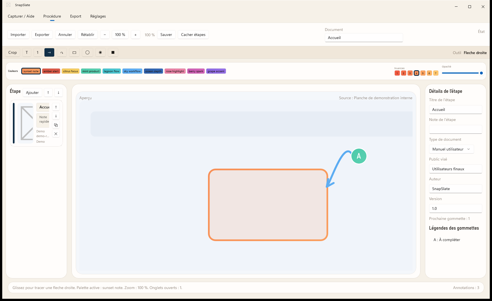

# SnapSlate

[](https://github.com/rangornrar/SnapSlate/actions/workflows/build.yml)

Application Windows en C# / WinUI 3 pour transformer des captures d’écran en guides illustrés.



## Utilisation

1. Télécharger `SnapSlate-Setup.exe` depuis les [versions publiées](https://github.com/rangornrar/SnapSlate/releases/latest).
2. Installer puis ouvrir SnapSlate.
3. Réaliser une capture avec `Win + Shift + S` : lorsque SnapSlate est ouverte, la capture est importée dans un nouvel onglet.
4. Ajouter textes, flèches, gommettes, cadres, zones de focus ou de masquage.
5. Enregistrer le projet `.snapslate` ou exporter les documents.

L’application doit être ouverte pour importer les captures du presse-papiers. Elle ne remplace pas le raccourci système lorsqu’elle est fermée. Le menu Fichier → Importer le presse-papiers (`Ctrl + Shift + V`) permet aussi de créer volontairement une nouvelle étape avec la même image ; chaque insertion est annulable.

## Formats et fonctionnalités

- Recadrage, palettes, réglage d’opacité et légendes de gommettes.
- Plusieurs captures/étapes, annulation et rétablissement.
- Projets JSON `.snapslate` v2 : métadonnées du guide indépendantes des titres d’étapes, reprise des projets v1.
- Aperçu et images exportées issus du même moteur de rendu ; seuls les recadrages confirmés sont exportés.
- Réglages appliqués avec Enregistrer ou abandonnés avec Annuler/Échap ; progression et annulation des exports.
- Export d’images PNG et de guides PDF, DOCX, Markdown et HTML.
- Liste d’objets et commandes de déplacement accessibles au clavier ; interface français / anglais.
- OCR Windows pour ajouter du texte reconnu à la capture.
- Publication Notion et Confluence Cloud explicitement limitée au texte, sans transfert des captures ; copie du package complet dans un dossier SharePoint synchronisé.

Les exports HTML et Markdown référencent le sous-dossier `images/` : conserver le dossier exporté complet lors du partage.

## Développement sous Windows

Prérequis : Windows 10/11, SDK .NET fixé par `global.json` et outils Windows/WinUI avec le SDK Windows ciblé par `SnapSlate.csproj`. Les lockfiles NuGet sont versionnés ; la CI restaure avec `--locked-mode`.

Depuis la racine du dépôt :

```powershell
dotnet restore .\SnapSlate.csproj -p:Configuration=Release -p:Platform=x64 -p:RuntimeIdentifier=win-x64 -p:PublishReadyToRun=false --locked-mode
dotnet build .\SnapSlate.csproj -c Release -p:Platform=x64 -r win-x64 -p:PublishReadyToRun=false --no-restore
dotnet test .\tests\SnapSlate.Tests.csproj -c Release -p:Platform=x64 --filter "TestCategory!=Performance"
```

Pour préparer les fichiers exécutables sans packaging MSIX :

```powershell
.\installer\Build-Installer.ps1 -Configuration Release
```

Les fichiers sont placés dans `installer/dist/app/`. Lancer `SnapSlate.exe` depuis ce dossier sous Windows. Le setup Inno et cette archive autonome constituent les distributions supportées ; les anciens scripts MSIX ont été retirés.

Pour produire le setup avec Inno Setup (version fixée dans `eng/toolchain.json`) installé :

```powershell
.\installer\Build-SetupExe.ps1
```

Résultat : `installer/release/SnapSlate-Setup.exe`, archive portable, empreintes SHA-256 et provenance de build. La CI construit ces distributions puis vérifie installation silencieuse, lancement et désinstallation sur un runner Windows jetable. La création d’une release reste explicite. Voir [construction et signature](installer/README.md).

La release actuelle est **non signée Authenticode** : aucun certificat de production n’est disponible. La chaîne peut signer l’application et le setup lorsqu’un certificat sera fourni ; elle ne modifie aucun magasin de confiance.

## Architecture et qualité

- [Architecture et limites actuelles](docs/ARCHITECTURE.md)
- [Décisions de conception](docs/decisions/README.md)
- [Périmètre des tests et vérifications manuelles](docs/QUALITY.md)
- [Validation du lot 3 et mesures](docs/LOT3_VALIDATION.md)
- [Contribuer](CONTRIBUTING.md) · [Sécurité](SECURITY.md)

Le code source et les binaires ne disposent pas actuellement d’un fichier de licence général dans ce dépôt. Les dépendances ont leurs propres conditions d’utilisation.

## Sauvegarde et masquage

Le projet éditable `.snapslate` conserve les sources originales. Les masques sont appliqués de manière opaque aux images exportées ; ils ne suppriment pas les pixels du projet. Les fichiers `.bak` contiennent la version précédente du projet. Exporter un PNG ne remplace pas la sauvegarde du projet.

Les guides exportés utilisent le nom du fichier source, sans son chemin local complet. Les textes saisis dans les titres, notes et légendes restent du contenu éditorial et sont partagés tels quels.
